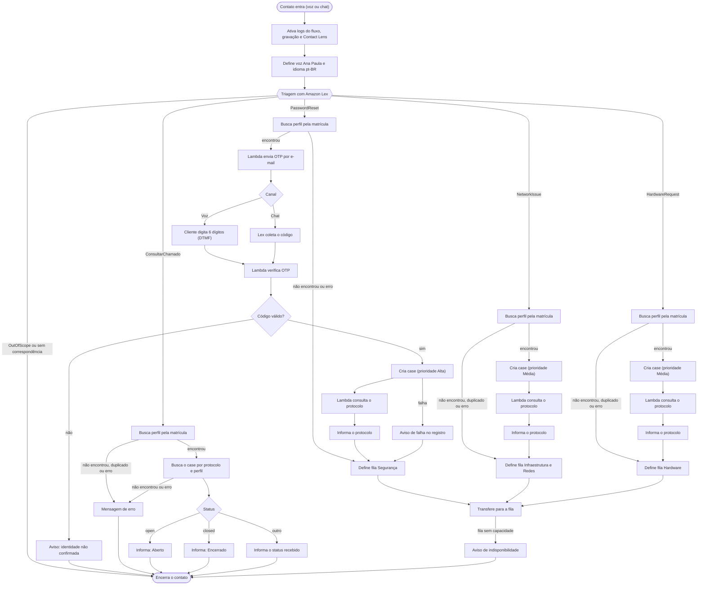

# FINOPS | Service Desk de TI na AWS: Amazon Connect, Lex, Cases e Lambda

Documentação do fluxo de atendimento do **Service Desk de TI** (voz e chat) construído sobre Amazon Connect, com o **modelo de custos e as práticas de FinOps** aplicadas a um cenário de **1.000 ligações por dia**.

> **Status:** fluxo de testes (`Fluxo-ServiceDesk-TI-TESTE-Protocolo`), publicado, `us-east-1`.
> **Escopo de custo:** service desk **interno**: telefonia (número DID e minutos de entrada) **não incluída**.

<!-- Espaço reservado para a imagem de abertura -->

## 1. Visão geral

O fluxo recebe o contato do funcionário (voz ou chat), usa um bot do **Amazon Lex** para entender o que ele precisa e executa automaticamente a parte repetitiva do atendimento:

| Intent do Lex | O que o fluxo faz | Destino |
|---|---|---|
| `PasswordReset` | Localiza o funcionário, confirma identidade por **OTP enviado por e-mail**, abre um case de prioridade alta | Fila de **Segurança** |
| `NetworkIssue` | Localiza o funcionário, abre um case de prioridade média | Fila de **Infraestrutura e Redes** |
| `HardwareRequest` | Localiza o funcionário, abre um case de prioridade média | Fila de **Hardware** |
| `ConsultarChamado` | Consulta o case pelo número de protocolo e informa o status | Autoatendimento (encerra o contato) |
| `OutOfScope` (ou sem correspondência) | Encerra o contato | Sem atendimento |

---

## 2. O fluxo de atendimento

### 2.1 Diagrama

### 2.2 Passo a passo

**Preparação (todo contato)**

1. **Logs do fluxo** ativados (`UpdateFlowLoggingBehavior`).
2. **Contact Lens** para chat (análise e sentimento, idioma pt-BR) e para voz (análise pós-contato e de interações automatizadas, sentimento). A **gravação de voz** cobre atendente e cliente, inclusive a URA. A **redação (mascaramento) de dados sensíveis está desligada**.
3. **Voz e idioma:** voz `ANA_PAULA` (motor `connect:agentic`) e idioma `pt-BR`.
4. **Triagem com Lex:** o bot dá as boas-vindas, explica o que sabe fazer e identifica o intent. Se nada corresponder, o contato é encerrado.

**Recuperação de senha (`PasswordReset`)**

1. O Lex captura a matrícula; o fluxo busca o **perfil** no Customer Profiles (`_account`).
2. Se encontrou, a Lambda `edn-validar-identidade-otp` (`SEND_OTP`) envia um código de 6 dígitos para o e-mail de recuperação (validade de 5 minutos).
3. O fluxo verifica o canal:
   - **Voz:** o cliente digita o código no teclado (`#` para confirmar, até 150 s, 6 dígitos).
   - **Chat:** o Lex coleta o código (intent `InformarCodigoOTP`).
4. A mesma Lambda (`VERIFY_OTP`) valida o código. Se não for `VERIFIED`, o fluxo informa que não foi possível confirmar a identidade e **encerra** (não há nova tentativa dentro da mesma ligação).
5. Se válido: cria um **case** (título "Conta corporativa bloqueada", prioridade Alta, vinculado ao contato), consulta o protocolo pela Lambda `edn-consultar-protocolo`, informa o número e **transfere para a fila de Segurança**.
6. Se a matrícula não for encontrada, houver registros duplicados ou a criação do case falhar, o cliente é **encaminhado à fila de Segurança sem protocolo**, com aviso.

**Problema de rede (`NetworkIssue`) e solicitação de hardware (`HardwareRequest`)**

1. Busca do perfil pela matrícula.
2. Criação do case (prioridade Média): "Problema de conexão de rede" ou "Solicitação de equipamento de TI".
3. A Lambda `edn-consultar-protocolo` devolve o `reference_number`; o fluxo informa o protocolo ao cliente.
4. Transferência para a fila de **Infraestrutura e Redes** ou de **Hardware**.
5. Se o perfil não for encontrado (ou houver duplicidade), o cliente vai para a fila **sem case criado**. Se a Lambda não devolver o protocolo, ele vai para a fila (no caso de hardware, com aviso).

**Consulta de chamado (`ConsultarChamado`)**

1. O Lex captura a matrícula e o número do protocolo.
2. O fluxo valida o perfil e busca o case (`GetCase`) por `customer_id` + `reference_number`.
3. Informa protocolo, assunto e status (**Aberto** ou **Encerrado**; outros status são lidos como vieram) e encerra o contato. É **autoatendimento puro**, sem fila.

**Tratamento de erros**

| Situação | Comportamento |
|---|---|
| Erro genérico (voz, idioma, Lex, transferência) | Mensagem de dificuldade técnica e encerramento |
| Fila sem capacidade | Mensagem de indisponibilidade e encerramento |
| Matrícula ou protocolo não encontrado/duplicado (consulta) | Mensagem e encerramento |
| Lambda com timeout (8 s, síncrona) | Segue para a fila ou encerra, conforme o ramo |

---

## 3. Componentes AWS e papel de cada um

| Componente | Papel neste projeto |
|---|---|
| **Amazon Connect** (voz, filas, fluxo) | Recebe o contato, executa o fluxo, transfere para os agentes |
| **Amazon Lex V2** | Entende o intent e coleta slots (matrícula, protocolo, código OTP) |
| **Connect Customer Profiles** | Cadastro do funcionário (`_account` = matrícula, nome, sobrenome) |
| **Connect Cases** | Registro dos chamados (modelo único, com protocolo `reference_number`) |
| **AWS Lambda** `edn-validar-identidade-otp` | Envia e valida o OTP (ações `SEND_OTP` e `VERIFY_OTP`) |
| **AWS Lambda** `edn-consultar-protocolo` | Recupera o protocolo do case recém-criado (`caseId`) |
| **Contact Lens** | Análise de conversa e sentimento (voz e chat) |
| **Amazon S3** | Gravações de voz, transcrições/análises do Contact Lens e exportações |
| **Amazon CloudWatch Logs** | **Logs de execução do fluxo**, do Lex e das Lambdas |
| **Amazon SES / DynamoDB** (apoio ao OTP) | Envio do e-mail e armazenamento do código (premissa de arquitetura) |

> Os logs de **fluxo** do Connect vão para o **CloudWatch Logs**, não para o S3. O S3 guarda gravações, transcrições e exportações.

---

## 4. Modelo de custos (cenário de 1.000 ligações/dia)

### 4.1 Premissas

| Premissa | Valor | Origem |
|---|---|---|
| Ligações | 1.000/dia, 30 dias = **30.000/mês** | Cenário definido |
| Mix de intents | Senha 30%, Rede 25%, Hardware 15%, Consulta 20%, Fora de escopo 10% | **Estimativa** (substituir pelo histórico real) |
| Duração faturável por ligação (URA + fila + agente) | Senha 9 min, Rede 11, Hardware 8, Consulta 2, Fora de escopo 1 → **média 7,15 min** → **214.500 min/mês** | **Estimativa** |
| Perfil encontrado | 95% | Estimativa |
| OTP validado com sucesso | 85% | Estimativa |
| **Cases criados** | ~622/dia → **~18.700/mês** | Derivado do fluxo e das premissas acima |
| Consultas de perfil | 900/dia (todos os intents, exceto fora de escopo); todos perfis únicos | Estimativa conservadora |
| Requisições de fala do Lex | 5 por ligação → 150.000/mês | Estimativa |
| Invocações Lambda | ~1.190/dia → **~36 mil/mês**, 0,5 s, 512 MB | Derivado do fluxo |
| Gravação | ~1 MB por minuto → ~210 GB/mês | Estimativa |

### 4.2 Custo mensal (cenário base)

| Item | Cálculo | US$/mês | % |
|---|---|---:|---:|
| Amazon Connect, voz (plano Customer, IA inclusa) | 214.500 min × 0,038 | 8.151 | 73,1% |
| Cases | 18.700 × 0,12 | 2.240 | 20,1% |
| Lex V2 (fala) | 150.000 × 0,004 | 600 | 5,4% |
| Customer Profiles | 900/dia × 30 × 0,005 | 135 | 1,2% |
| Lambda | ~36 mil invocações × 0,5 s × 512 MB | ~0,20 | < 0,1% |
| S3 (gravações + Contact Lens) | ~210 GB/mês | ~5 no mês 1; ~58 no mês 12 e ~173 no mês 36, sem lifecycle | 0,0% |
| CloudWatch Logs (fluxo, Lex, Lambda) | ~5 GB | ~5 | < 0,1% |
| Extras (SES para o OTP, DynamoDB) | estimativa | ~10 | 0,1% |
| **Total (mês 1)** | | **≈ 11.150** | 100% |
| **Custo por ligação** | 11.150 ÷ 30.000 | **≈ US$ 0,37** | |

**Pareto:** voz + Cases + Lex somam **~99%** do custo. Lambda, S3 e CloudWatch são irrelevantes, mas o S3 **cresce todo mês** sem retenção.

### 4.3 Custo unitário por intent (custo direto por ligação)

| Intent | Voz | Lex | Perfil | Case | **Por ligação** | **Total/mês** |
|---|---:|---:|---:|---:|---:|---:|
| Senha | 0,342 | 0,020 | 0,005 | 0,097 | **0,464** | 4.175 |
| Rede | 0,418 | 0,020 | 0,005 | 0,114 | **0,557** | 4.178 |
| Hardware | 0,304 | 0,020 | 0,005 | 0,114 | **0,443** | 1.993 |
| Consulta | 0,076 | 0,020 | 0,005 | n/a | **0,101** | 606 |
| Fora de escopo | 0,038 | 0,020 | n/a | n/a | **0,058** | 174 |
| Soma dos custos diretos | | | | | | 11.126 |
| Custos compartilhados (S3, CloudWatch, Lambda, extras), a ratear | | | | | | ~20 |

Valores de coluna em US$. Custos compartilhados podem ser rateados pelos minutos de cada intent.

### 4.4 Sensibilidade à duração média

| Cenário | Duração média | Minutos/mês | Total/mês (US$) | Por ligação (US$) |
|---|---:|---:|---:|---:|
| Baixo | 5 min | 150.000 | ≈ 8.700 | 0,29 |
| **Base** | **7,15 min** | **214.500** | **≈ 11.150** | **0,37** |
| Alto | 10 min | 300.000 | ≈ 14.400 | 0,48 |

**Regra prática:** cada **1 minuto** a menos na duração média economiza cerca de **US$ 1.140/mês** (30.000 × 0,038).

### 4.5 O que não está incluído

- **Telefonia** (número DID e minutos de entrada): excluída por ser service desk interno. Se os funcionários ligarem pelo navegador ou pelo app (**in-app calling**), pode haver cobrança de comunicação de **US$ 0,010/min** (~US$ 2.145/mês neste cenário).
- Impostos, conversão para reais, suporte AWS, CloudTrail e KMS.
- Custo dos **agentes**, implantação, desenvolvimento e o canal de **chat** (o cenário considera só voz).

---

## 5. Práticas FinOps aplicadas

A abordagem segue as três fases do ciclo FinOps: **Informar → Otimizar → Operar**.

### 5.1 Informar (visibilidade e alocação)

| Prática | Como aplicar neste projeto |
|---|---|
| **Padrão de tags** | `Project=ServiceDeskTI`, `Environment=test\|prod`, `Owner`, `CostCenter`, `Service=ServiceDesk`. Aplicar em instância Connect, bot Lex, Lambdas, buckets S3 e grupos de logs |
| **Separar ambientes** | O fluxo é de **teste**: usar instância/conta separada de produção para que o custo de testes não contamine a linha de base |
| **Alocação por fila/equipe (showback)** | Rateio do custo de voz por fila (Segurança, Redes, Hardware) a partir dos registros de contato (CTR) e dos minutos por fila, pois o custo do Connect é por instância (validar o nível de detalhe no seu CUR) |
| **Economia unitária** | Acompanhar custo por ligação (US$ 0,37), por case e por intent (seção 4.3) |

### 5.2 Otimizar (taxa e uso)

| Prática | Aplicação |
|---|---|
| **Atacar o que pesa (Pareto)** | Focar em minutos de voz, volume de Cases e turnos do Lex (99% do custo) |
| **Reduzir uso** | Automatizar o reset de senha, reduzir tempo de fila/agente e turnos do Lex (seção 6) |
| **Escolha do plano** | Comparar o plano Connect Customer com o Customer Basic + adicionais; é preciso validar com a sua conta |
| **Retenção e classes de armazenamento** | Lifecycle no S3 (Standard → arquivamento → expiração) e retenção de 30 a 90 dias nos logs do CloudWatch |

### 5.3 Operar (governança contínua)

| Prática | Aplicação |
|---|---|
| **AWS Budgets** | Orçamento mensal de ~US$ 11.500 com alertas em 80% (previsto) e 100% (real), mais orçamento por tag |
| **Orçamento diário de referência** | ~US$ 372/dia (11.150 ÷ 30); alerta se passar de ~US$ 450 |
| **Detecção de anomalias** | AWS Cost Anomaly Detection no escopo da tag `Project=ServiceDeskTI` |
| **Revisão periódica** | Revisão mensal de custo x volume com TI e Finanças; reavaliar premissas a cada trimestre |

### 5.4 Indicadores (KPIs) sugeridos

| KPI | Referência (cenário base) |
|---|---|
| Custo por ligação | US$ 0,37 |
| Duração média faturável | 7,15 min |
| Cases criados por dia | ~622 |
| Turnos de fala do Lex por ligação | 5 |
| Variação real x previsto | dentro de ±10% |

---

## 6. Oportunidades de otimização

Ordenadas por impacto estimado (valores aproximados e dependentes das premissas):

| # | Ação | Impacto estimado | Esforço |
|---|---|---|---|
| 1 | **Automatizar o reset de senha** pela Lambda (hoje, após o OTP, o fluxo cria case e transfere para agente). Reduzir de ~9 para ~3,5 min | ~US$ 1.900/mês (+ economia de agente, fora deste modelo) | Médio |
| 2 | **Reduzir a duração média** (fila + atendimento): base de conhecimento para agentes, melhor roteamento | **US$ 1.140/mês por minuto reduzido** | Médio |
| 3 | **Evitar cases duplicados** (verificar case aberto da mesma matrícula/assunto antes de criar) | **US$ 224/mês a cada 10% de cases evitados** | Baixo |
| 4 | **Menos turnos do Lex** (menos confirmações, slots no mesmo turno) | **US$ 120/mês por requisição a menos por ligação** | Baixo |
| 5 | **Avaliar o plano Connect Basic + adicionais** | Estimativa de ~US$ 500/mês (fonte de terceiros; validar) | Baixo |
| 6 | **Lifecycle no S3** e retenção de logs | Evita crescimento linear (US$ 58 no mês 12, US$ 173 no mês 36) | Baixo |

---

## 7. Observações sobre o fluxo (segurança, LGPD e operação)

- **Dados sensíveis em gravação e análise:** a gravação do cliente está ativa e a **redação do Contact Lens está desligada** (voz e chat). A matrícula e o código OTP (digitados ou falados) podem ficar em gravações e transcrições. Recomenda-se **ativar a redação**, tratar o OTP apenas por DTMF/mascarado e definir a retenção conforme a LGPD.
- **Tentativas de OTP:** o fluxo permite uma tentativa por ligação, mas nada impede várias ligações seguidas. A Lambda deve **limitar tentativas por matrícula** e expirar o código.
- **Rede e hardware sem perfil encontrado:** o contato vai para a fila **sem case e sem protocolo**, quebrando a rastreabilidade. Considerar criar o case mesmo assim.
- **Limite de chamadas simultâneas:** verificar a cota da instância (o padrão é baixo) e pedir aumento antes de produção.
- **Identificadores da conta:** o JSON do fluxo contém ID da conta AWS, ID da instância, ARNs de filas e do bot Lex. **Não publique esses valores em repositório público**; substitua por placeholders (`<ACCOUNT_ID>`, `<INSTANCE_ID>`, `<QUEUE_ID>`, `<BOT_ALIAS_ID>`) antes do commit.

<!-- Espaço reservado para a segunda imagem -->

---

## 8. Limitações, premissas a validar e fontes

**Limitações do modelo**

- Mix de intents, duração por intent, taxa de perfis encontrados, taxa de OTP, turnos do Lex e MB/min de gravação são **estimativas**. Substitua pelos dados reais (CTR, relatórios do Connect e CloudWatch) assim que houver histórico.
- O **Lex** foi tratado como custo separado, por segurança; validar se o plano o inclui.
- **Customer Profiles:** assumida cobrança de US$ 0,005 por perfil/dia por serem perfis com dados importados (se não houver cobrança no seu caso, o impacto é de US$ 135/mês).
- Preços de Lambda, S3 e CloudWatch são de tabela pública e **não foram reconferidos**; o impacto é de poucos dólares.

**Checklist de validação antes de aprovar o orçamento**

- [ ] Plano contratado (Customer ou Basic) e preços atuais do Amazon Connect
- [ ] Simulação no AWS Pricing Calculator com estas premissas
- [ ] Duração média e mix de intents reais
- [ ] Cobrança de Customer Profiles e de Lex na conta
- [ ] Forma de entrada das ligações (PABX/SIP, in-app) e cobrança de comunicação

**Fontes**

- Preços e documentação oficiais da AWS: Amazon Connect (página de preços e apêndice), Amazon Lex (preços), AWS Lambda, Amazon S3 e Amazon CloudWatch.
- Estrutura do fluxo: arquivo `Fluxo-ServiceDesk-TI-TESTE-Protocolo.json` (53 ações).
